 

 

Xin chào! Mình là **Huy**, một lập trình viên đang khám phá không gian công nghệ và xây dựng những sản phẩm có ích, sáng tạo và có tính ứng dụng thực tế.
Mình thích biến ý tưởng thành code, học những công nghệ mới và phát triển bản thân qua từng dự án.

- 💻 Yêu thích lập trình và giải quyết vấn đề
- 🚀 Đam mê xây dựng ứng dụng web, backend và trải nghiệm người dùng
- 🌱 Luôn học hỏi và cập nhật các công nghệ mới
- 🧠 Mục tiêu: trở thành một developer toàn diện, có thể tạo ra sản phẩm có giá trị thực tế

 

  

<table align="center">
  <tr>
    <th>Frontend</th>
    <th>Backend</th>
    <th>Database &amp; Tools</th>
  </tr>
  <tr>
    <td align="center">
      
      
      
      
      
      
    </td>
    <td align="center">
      
      
      
      
    </td>
    <td align="center">
      
      
      
      
      
      
    </td>
  </tr>
</table>

 

- 🛰️ Tìm hiểu và áp dụng các công nghệ hiện đại
- 🪐 Phát triển các dự án cá nhân có tính thực tế
- ☄️ Nâng cao kỹ năng coding, design và teamwork
- 🌌 Mở rộng kiến thức về AI, Cloud và DevOps

 

  
  

  

  <picture>
    <source media="(prefers-color-scheme: dark)" srcset="https://raw.githubusercontent.com/tnHuy1809/tnHuy1809/section-mission.svg.svg" />
    <source media="(prefers-color-scheme: light)" srcset="https://raw.githubusercontent.com/tnHuy1809/tnHuy1809/section-mission.svg" />
    
  </picture>

 

- GitHub: [@tnHuy1809](https://github.com/tnHuy1809)
<!-- Bỏ comment và điền thông tin của bạn:
- Email: [your.email@example.com](mailto:your.email@example.com)
- Portfolio: [your-portfolio.dev](https://your-portfolio.dev)
-->

 

